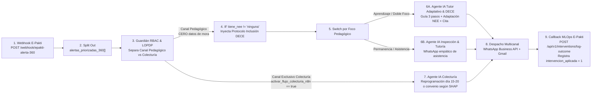

# Dossier Maestro del CEO: **E-Pakti** — Arquitectura Dual-Plane SaaS (`app.epakti.ec` + `admin.epakti.ec`), Motor Multinivel (`Macro + Meso + Micro`), 20 Endpoints REST, Orquestación n8n, MLOps y Prompt Maestro para Equipo UI/UX

> **Startup SaaS:** **E-Pakti** *(Plataforma Multi-Tenant de Inteligencia Educativa Preventiva, Permanencia y Sostenibilidad Escolar)*
> **Arquitectura Dual-Plane & Microservicio Desacoplado:** **Plano A (`app.epakti.ec`)** — Portal de cada Unidad Educativa cliente (6 Vistas RBAC) + **Plano B (`admin.epakti.ec`)** — Consola Interna del CEO, Data Science y MLOps de **E-Pakti** (5 Vistas de Gobierno) + **Motor Privado de Wilo (`engine.epakti.ec`)** conectado vía OpenAPI 3.1 (sin exponer el código ML al equipo web/UI).
> **Estado Científico Honesto:** **Prototipo Técnico Auditado — Listo para Piloto Controlado con Datos Fechados de un Colegio Real** (`18 / 18` pruebas reales + 4 pruebas de perturbación aprobadas en [`reporte_verificacion_integral_15_tests.json`](../motor_saas/reporte_verificacion_integral_15_tests.json)). *Las notas de la demo sintética carecen de fecha de publicación y aún no existen etiquetas reales de retiro definitivo; las simulaciones territoriales, el What-If y las cifras en USD son análisis de sensibilidad ilustrativos, no efectos causales ni ROI comprobado hasta validar en piloto real.*

---

## 1. Giro de Negocio de **E-Pakti**, Tesis del CEO y Arquitectura de Dos Planos

### 1.1. Propuesta de Valor y Foso Competitivo ("Por qué E-Pakti es una Startup SaaS Autónoma y Escalable")
**E-Pakti funciona de forma 100 % autónoma e independiente de cualquier software o ERP de terceros.** Un colegio en Ecuador o Latinoamérica **NO necesita tener Idukay, Runachay, Educalinks, Academium ni ninguna otra plataforma previa** para contratar ni operar E-Pakti: puede arrancar en minutos cargando sus propios registros en **plantillas Excel/CSV, Google Sheets, registro nativo dentro de E-Pakti o API genérica**. *Solo si la unidad educativa ya cuenta con un sistema externo* y desea evitar doble digitación, E-Pakti ofrece importación/conector **estrictamente opcional** (jamás requisito ni dependencia). Sobre los datos propios del plantel, E-Pakti aporta una arquitectura multinivel que ninguna plataforma administrativa escolar ecuatoriana posee, combinando **tres capas de evidencia** y un **efecto red de datos (*Data Flywheel*)**:

1. **Unión `Macro + Meso + Micro` (Elimina el Sesgo Territorial):** Un modelo que solo mira datos internos del colegio comete sesgos de hasta **`+18,8 pp` en familias con mora** y **`+22,6 pp` en alumnos de bajo rendimiento** en zonas vulnerables (dejando fuera del Top 40 de alertas a entre el **37,5 % y 47,5 %** de los casos reales). **E-Pakti** cruza automáticamente el código `AMIE` y la parroquia `DPA` de cada colegio y estudiante con el **Backbone Nacional Oficial de Ecuador** (**MINEDUC AMIE**: `30.559` cohortes plantel×grado, `6.441` colegios, `1.765.898` alumnos; **INEC Censo 2022**: `955+` parroquias homologadas al `99,96 %`; **INEC ENEMDU**: `24` provincias; **INEVAL Ser Estudiante** y **OCDE PISA 2025 Ecuador**).
2. **Motor Neuronal Monótono `TabM_mini-FiLM` Bivariado con Explicabilidad Exacta (PyTorch + GPU RTX 5070 en Backbone Nacional):** Combina *BatchEnsemble* de rango 1 (`TabM_mini`, *ICLR 2025*), *smooth clipping* (`RealMLP`, *NeurIPS 2024*), cabeza analítica Poisson bivariada y transformación `Softplus` que garantiza matemáticamente que **el 100 % de las 36 variables en los 6 modelos oficiales tengan signos coherentes con la teoría económica y educativa** ($r > 0$ e $\text{IME}_{+1\text{SD}} > 0$, `VIF <= 5,19`), descompone cada predicción individual con **Valores de Shapley Exactos** (error máximo = `0,0200 pp`, estabilidad operativo vs. OOF `MAE = 1,25 pp`, cola exportada Permanencia `23/40` sin dilución Q2) y simula sensibilidades de puntaje por intervención (*Asistencia*, *Tutoría/DECE* o *Convenio Colecturía*). En validación externa real acelerada en GPU NVIDIA RTX 5070 con ablaciones controladas, alcanza **`ROC-AUC = 0,7360`** (`+1,76 pp` puro aporte territorial) en AMIE Ecuador 2025 (`1,62M` estudiantes), **`ROC-AUC = 0,8335`** (`+505` deserciones al exacto mismo cupo `64.971`) en MINEDUC Chile 2025 (`1,30M` estudiantes) y **`Precisión@737 = 93,35 %` (`AUC = 0,9015`)** en UCI Portugal (`4.424` estudiantes). Ver informe completo en [`INFORME_MEJORA_MODELOS_SOTA_GPU_2026.md`](INFORME_MEJORA_MODELOS_SOTA_GPU_2026.md).
3. **Aislamiento RBAC + Cumplimiento Legal (LOEI / LOPDP Ecuador):** Reemplaza letras bancarias estigmatizantes (`AAA`–`C`) por un **Sistema de Semaforización Escolar Calibrada (`Verde / Amarillo / Naranja / Rojo`)** estrictamente separado por rol: los docentes ven **CERO datos financieros de los padres**, y Colecturía tiene su propio semáforo de pagos y su propio agente en n8n.
4. **Arquitectura Dual-Plane + Data Flywheel MLOps Multi-Colegio:**
   * **PLANO A (`app.epakti.ec` — Tenant Plane / Portal del Colegio Cliente):** Cada colegio suscrito accede únicamente a sus propios estudiantes y tableros por rol (`Rectorado`, `Docente Tutor`, `DECE`, `Inspección`, `Colecturía`, `Admisiones`). **Un colegio cliente jamás ve la consola MLOps interna ni datos de otros colegios.**
   * **PLANO B (`admin.epakti.ec` — Control Plane / Consola Interna de E-Pakti):** Es el centro de mando exclusivo del **CEO y del equipo de Data Science / MLOps / Customer Success de E-Pakti** para gestionar toda la red de colegios conectados, explorar el **Data Lake k-anónimo (CERO nombres, CERO cédulas — LOPDP)**, monitorear `PSI` de Data Drift y `ECE` de calibración, protegerse contra *Feedback Loops* por intervenciones, **re-entrenar los modelos con la red multi-colegio**, aprobar los **5 Candados *Champion vs. Challenger***, activar ***Feature Flags* / planes comerciales** y lanzar actualizaciones *Canary* (primero en el 10–20 % de colegios piloto) con *Rollback* en 1 clic.

```
========================================================================================================
                         ARQUITECTURA DUAL-PLANE DE LA SAAS E-PAKTI
========================================================================================================

  [PLANO A: PORTAL DEL COLEGIO CLIENTE — app.epakti.ec]        [PLANO B: CONSOLA INTERNA E-PAKTI — admin.epakti.ec]
  Aislado por `school_id` (JWT: TENANT_SCHOOL)                 Exclusivo equipo E-Pakti (JWT: EPAKTI_CONTROL_PLANE)
  -----------------------------------------------------        -----------------------------------------------------
  A1. Rectorado & Escenario Financiero ($35,7k ilustrativo)    B1. Centro de Comando CEO & Mapa Multi-Tenant (MRR/Ingesta)
  A2. Matriz Triage Docente/Inspección (0 datos mora)          B2. Data Lake K-Anónimo (LOPDP) & Fuentes AMIE/Censo
  A3. Drawer Ficha 360°: Cascada SHAP + What-If + n8n          B3. MLOps Studio: Re-entrenar + 5 Candados + Canary
  A4. Bandeja Psicopedagógica DECE (92 alumnos NEE)            B4. Monitor Drift (PSI/ECE), Feedback Loops & Salud n8n
  A5. Colecturía Exclusiva (204 hogares + Porqué SHAP)         B5. Gestión de Planes, Feature Flags & Rollout Progresivo
  A6. Admisiones Pre-Ingreso (N=1) & Control Docente
                          \                                                       /
                           \   EP-01 a EP-11 (REST API)     EP-12 a EP-18 (API)  /
                            v                                                   v
                  +-----------------------------------------------------------------------+
                  |        BACKEND FASTAPI + MOTOR E-PAKTI (PyTorch FiLM + SHAP)          |
                  |   Backbone Nacional (1,76M AMIE) + Red Multi-Escuela + Empirical Bayes |
                  +-----------------------------------------------------------------------+
                           |                                                     ^
                           v  POST /webhook/epakti-alerta-360                    | POST /api/v1/interventions/log-outcome
                  +-----------------------------------------------------------------------+
                  |   ORQUESTADOR AGÉNTICO n8n (9 Nodos con Guardián RBAC + Agentes IA)   |
                  |   WhatsApp Business API + Gmail + Bitácora MTSS (Candado Feedback)    |
                  +-----------------------------------------------------------------------+
```

### 1.2. Escenario Ilustrativo de Exposición de Cartera (Demo 240 Alumnos, 204 Familias — *No es ROI Causal Comprobado*)
* **Colegiatura Anual Neta del Plantel (10 meses):** `\$401.357,50 USD` (pensión mensual neta promedio: `\$167,23 USD`).
* **Cartera Restante del Ciclo (`Nov–Jun`, 8 meses):** `\$321.086,00 USD`.
* **Cartera Restante Expuesta en Alertas Activas 360° (`Rojo/Naranja`):** `\$164.872,00 USD`.
* **Nota de Rigor Científico para el Copy Web y Pitch:** La reducción simulada de puntaje en el simulador *What-If* mide **sensibilidad predictiva del modelo al modificar variables de entrada** (no un efecto causal estimado de una intervención). Las cifras de exposición en USD son **escenarios ilustrativos de cartera bajo riesgo**; el ROI real de retención se medirá exclusivamente tras registrar intervenciones y cierres reales en el primer colegio piloto.
* **Evidencia Nacional Sin Fuga Temporal (`motor_nacional_amie_censo.py`):** Evaluando `30.559` pares plantel×curso de Ecuador (`6.441` colegios, `1.765.898` alumnos, `40.646` abandonos) con probabilidad cruda sin recentrado futuro y ordenando por matrícula del año previo (`2023–2024`), el modelo con contexto Censo 2022 + ENEMDU detecta **19.821 vs. 19.603** abandonos en el Top 10 % (**+218 abandonos adicionales**, Brier `0,02220` vs `0,02225`, sesgo medio `-0,94 pp`).
* **Líneas Base Transparentes en la Demo (`N = 240`):** El Logit simple de asistencia verificable (`AP = 0,526`, `23/70` en cupo 40) y el Logit de promedio Q1 P1–P2 (`AP = 0,941`, `40/40` en Q2) permanecen como **referencias base obligatorias**. Las metas de pago distinguen explícitamente entre **incumplimiento o pago tardío > día 10** (`72` casos en 1+ mes y `24` en 2+ meses) frente a **mora impaga estricta** (`37` casos en 1+ mes y `6` en 2+ meses).

---

## 2. Benchmark EdTech y Evolución sobre el Boceto Exploratorio Previo

| Plataforma | Origen / Escala | ¿Usa Data Science? | Relación con **E-Pakti** |
| --- | --- | :---: | --- |
| **Plataformas administrativas locales** *(ej. Idukay, Runachay, Educalinks, Academium)* | Ecuador (`+1.800` colegios) | **No (0 de 4)** | **Sistemas externos independientes (NO requeridos por E-Pakti):** **E-Pakti** opera 100 % autónomo con Excel/CSV, registro propio o API sin esperar ni depender de ninguna de estas apps. Solo *si el colegio ya usa una* y quiere importar sus tablas, puede conectarla de forma **opcional**. |
| **uPlanner (`uRetention`)** | Chile/LatAm (`+150` univ.) | **Sí** | Referente de ROI financiero en USD y alertas por WhatsApp; enfocado en universidades. **E-Pakti** conquista K-12 sumando **Censo 2022 + ENEMDU + AMIE + Red FiLM Monótona + RBAC LOPDP**. |
| **Mainstay / Branching Minds / Panorama (`Solara`) / Civitas** | EE. UU. (`USD 56M – 1.080M`) | **Sí** | **E-Pakti** reúne lo mejor de las cuatro para LatAm: WhatsApp proactivo (Mainstay) + Bandeja MTSS/DECE NEE (Branching Minds) + Clima INEVAL/PISA (Panorama) + Simulador Contrafactual de Uplift (Civitas). |

* **Qué superamos respecto al boceto exploratorio previo (`Pipeline_Completo_PAKTAI...pdf`):** Eliminamos la generación aleatoria de NEE/bienestar (`np.random.choice`), eliminamos los pesos inventados a mano sin validación, eliminamos la fuga temporal anual, separamos por RBAC la mora de la vista docente e incorporamos la **Consola Interna de E-Pakti (`admin.epakti.ec`)** para gobernar el Data Flywheel multi-colegio.

---

## 3. Modelos Validados, Semaforización Calibrada e Indicadores Estimados

### 3.1. Desempeño Out-of-Fold (`5×4` CV por Hogar) y Calibración de los Semáforos ([`auditoria_calibracion_semaforos.csv`](../resultados/auditoria_calibracion_semaforos.csv))

| Semáforo Calibrado (`TabM_mini-FiLM` Bivariado + Calibración Regularizada) | Rol Autorizado (RBAC) | 🟢 VERDE (Obs. / Pred.) | 🟡 AMARILLO (Obs. / Pred.) | 🟠 NARANJA (Obs. / Pred.) | 🔴 ROJO (Obs. / Pred.) | `ROC-AUC` | `ECE` (pp) | Lift vs. Prev. |
| --- | --- | :---: | :---: | :---: | :---: | ---: | ---: | ---: |
| **1. Permanencia / Asistencia** *(En Curso Oct 31, 3 niveles; OOF `22/40`, Cola `23/40`)* | Docentes / Inspección / DECE | **7,9 %** / `13,3 %` (`n=101`) | **38,3 %** / `26,7 %` (`n=60`) | *(Agrupado en 3 niveles)* | **49,4 %** / `51,6 %` (`n=79`) | **`0,7676`** | **5,89** | **1,69×** *(6,23× R/V)* |
| **2. Desempeño Académico Q2 `< 7,0`** *(En Curso)* | Docentes / Vicerrect. / DECE | **3,1 %** / `5,1 %` (`n=128`) | **28,3 %** / `26,1 %` (`n=46`) | **56,5 %** / `55,7 %` (`n=23`) | **95,3 %** / `91,8 %` (`n=43`) | **`0,9466`** | **2,16** | **3,22×** *(30,51× R/V)* |
| **3. Morosidad Crónica $\ge 2$ Meses** *(Nov–Ene, Household EB)* | **EXCLUSIVO** Colecturía | **0,0 %** / `6,2 %` (`n=72`) | **8,3 %** / `6,9 %` (`n=120`) | **26,5 %** / `18,5 %` (`n=34`) | **35,7 %** / `35,9 %` (`n=14`) | **`0,7649`** | **3,71** | **3,57×** *(Verde=0)* |
| **4. Pre-Ingreso Educativo M1** *(Diagnóstico)* | Admisión / DECE Día 1 | **5,5 %** / `5,8 %` (`n=127`) | **16,7 %** / `22,5 %` (`n=36`) | **48,3 %** / `46,5 %` (`n=29`) | **91,7 %** / `87,3 %` (`n=48`) | **`0,9283`** | **2,11** | **3,10×** *(16,63× R/V)* |
| **5. Pre-Ingreso Financiero M1** *(Solo Matrícula Sep, 3 colores)* | **EXCLUSIVO** Admisiones / Colect. | **24,6 %** inc. / **2,9 %** crón. (`n=69`) | **27,3 %** inc. / **7,9 %** crón. (`n=139`) | *(Agrupado en 3 niveles)* | **53,1 %** inc. / **34,4 %** crón. (`n=32`) | **`0,6867`** crón. | **2,16 / 2,84** | **3,44×** crón. |

* **Conteo Exacto Verificado del Semáforo Docente Integrado (`max(Permanencia, Académico)`, cero datos financieros):** 🔴 **ROJO: `94`** | 🟠 **NARANJA: `12`** | 🟡 **AMARILLO: `54`** | 🟢 **VERDE: `80`** (Total = `240`).
* **Efecto Red MLOps Multi-Colegio ([`simulacion_flywheel_mlops_multicolegio.csv`](../motor_saas/simulacion_flywheel_mlops_multicolegio.csv)):** Al pasar de `1` a `25` colegios anonimizados (`240 → 6.000` estudiantes), el desempeño *Zero-Shot* en colegios nuevos nunca vistos sube en `ROC-AUC` de `0,8404` a **`0,8622`**, `AP` de `0,8819` a **`0,8996`**, `Brier` baja de `0,1808` a **`0,1500`**, y el error de calibración `ECE` cae **5 veces** (`11,39 pp → 2,27 pp`). El candado de registro de intervención (`intervencion_aplicada = 1`) evita el colapso por *Feedback Loop* (`ECE = 2,22 pp` vs. `23,56 pp` en re-entrenamiento ingenuo).

### 3.2. Diccionario de los Indicadores Estimados y Auditados (`36/36` Signos Teóricos `100 %` Coherentes, `VIF <= 5,19`)
Catálogo completo de los **48 indicadores** con sus estadísticos exactos en [`catalogo_completo_indicadores_estimados_saas.csv`](../resultados/catalogo_completo_indicadores_estimados_saas.csv) y auditoría formal en [`auditoria_limpieza_y_signos_economicos.csv`](../resultados/auditoria_limpieza_y_signos_economicos.csv):

| Bloque / Variable Principal | Fórmula / Fuente | Media (DE) | Signo | $r$ Bivariado | `VIF` | $\text{IME}_{+1\text{SD}}$ | Permiso RBAC |
| --- | --- | :---: | :---: | :---: | :---: | :---: | --- |
| `tasa_injustificada_historica` | Faltas injustificadas `Sep–Oct` / 44 (`asistencia.csv`) | `0,0361` (`0,0308`) | `+` | **`+0,3505`** | `4,32` | **`+5,40 pp`** | Docente / Inspección / DECE |
| `tasa_justificada_historica` | Faltas justificadas `Sep–Oct` / 44 (`asistencia.csv`) | `0,0322` (`0,0271`) | `+` | **`+0,3346`** | `1,50` | **`+5,92 pp`** | Docente / Inspección / DECE |
| `racha_injustificada_historica` | Máx. días seguidos de falta injustificada | `1,158` (`0,838`) | `+` | **`+0,3090`** | `2,34` | **`+2,51 pp`** | Docente / Inspección / DECE |
| `persistencia_injust_sep_oct` | `min(tasa_injust_sep, tasa_injust_oct)` (persistencia bi-mes pre-corte) | `0,0119` (`0,0211`) | `+` | **`+0,2596`** | `2,56` | **`+0,98 pp`** | Docente / Inspección / DECE |
| `prop_materias_bajo_7_corte` | Fracción de notas $< 7,0$ en `Q1 P1–P2` (`notas.csv`) | `0,2610` (`0,2875`) | `+` | **`+0,7513`** *(Q2)* | `4,64` | **`+10,06 pp`** | Docente / Tutor / DECE |
| `n_materias_criticas_bajo_6_corte` | Conteo de asignaturas severas $< 6,0$ al corte | `0,4250` (`0,8597`) | `+` | **`+0,6556`** *(Q2)* | `2,97` | **`+8,33 pp`** | Docente / Tutor / DECE |
| `deficit_mat_vs_umbral_7` / `deficit_len_vs_umbral_7` | `7,0 - Nota` en **escala escolar `0–10` pura** *(sin mezclar con escala IRT INEVAL `0–1000`)* | `-0,62` / `-0,76` | `+` | **`+0,6019` / `+0,6356`** | `2,39 / 2,98` | **`+6,14 / +6,59 pp`** | Vicerrectorado / Docente |
| `brecha_materia_critica_nee` | Déficit bajo `7,5` en materia crítica de su NEE | `0,3366` (`0,6559`) | `+` | **`+0,3638`** *(Q2)* | `1,34` | **`+1,54 pp`** | DECE / Psicopedagogía |
| `efecto_fijo_docente_corte` | Tasa media $< 7,0$ de los docentes asignados al alumno | `0,331` (`0,018`) | Control | Control severidad | — | Control | Vicerrectorado / E-Pakti |
| `hogar_tasa_incumpl_eb` | Tasa suavizada *Empirical Bayes* de incumplimiento familiar (pooling entre hermanos) | `0,2131` (`0,1767`) | `+` | **`+0,2696` / `+0,3794`** | `5,19` | **`+4,08 / +2,94 pp`** | **EXCLUSIVO Colecturía** |
| `exceso_dia_pago_sobre_vencimiento` | $\max(0, \text{Día\_Medio\_Pago} - 5)$ en pagados | `2,958` (`3,795`) | `+` | **`+0,2708` / `+0,3505`** | `2,67` | **`+5,01 / +2,58 pp`** | **EXCLUSIVO Colecturía** |
| `cuotas_vencidas_pre` | Cuotas vencidas impagas al `31-oct` | `0,1208` (`0,3390`) | `+` | **`+0,2417`** *(Crón.)* | `2,77` | **`+0,19 pp`** | **EXCLUSIVO Colecturía** |
| `hogar_tardios_hermanos_extra` | Pagos tardíos adicionales en hermanos del representante | `0,1125` (`0,3770`) | `+` | `+0,1174` / `+0,1262` | `1,30` | **`+2,39 / +1,22 pp`** | **EXCLUSIVO Colecturía** |
| `inter_ausencia_x_bajo7_ort` | $\max(0, \text{Aus}-0,05)\times\max(0, \text{Bajo7}-0,14)$ | `0,0051` (`0,0117`) | `+` | **`+0,3250` / `+0,4188`** | `2,54` | **`+1,18 pp`** | Motor Neuronal / SHAP |
| `inter_bajo7_x_brecha_digital_ort` | $\text{Bajo7} \times \max(0, \text{SinInternet}_{\text{Censo}} - 0,15)$ | `0,0152` (`0,0217`) | `+` | **`+0,1905`** | `2,52` | **`+0,32 pp`** | Motor Multinivel / SHAP |
| `inter_friccion_pago_x_nbi_ort` | $(\text{Tardíos}+\text{Vencidas})\times\max(0, \text{NBI}-0,12)$ | `0,0617` (`0,1054`) | `+` | **`+0,2211` / `+0,2806`** | `1,63` | **`+2,54 / +1,37 pp`** | **EXCLUSIVO Colecturía** |
| `prior_macro_ortogonal` | Transferencia INEVAL + ENEMDU `<= 2024` (estrictamente pedagógico/territorial) | `0,0533` (`0,0716`) | `+` | **`+0,1418`** | `2,24` | **`+0,37 pp`** | Motor Multinivel / SHAP |
| `valor_riesgo_financiero_restante_usd` / `roi_esperado_retencion_360_usd` | $\text{Pensión Neta}\times 8\text{ m}$ y $\text{VRF}\times \Delta P_{360}$ | `$1.337,86` / `$137,84` | KPI ROI | Financiero | — | ROI Rectorado | **EXCLUSIVO Rectorado / E-Pakti** |

---

## 4. Catálogo Completo de los 20 Endpoints REST API de **E-Pakti** (`Plano Colegio` + `Plano Control E-Pakti` + `Landing`)

Especificación completa OpenAPI 3.1 con bloque estándar `"paths"` y ejemplos JSON de Request y Response en [`openapi_especificacion_endpoints_ui_n8n.json`](../motor_saas/openapi_especificacion_endpoints_ui_n8n.json).

### 4.1. Plano A — Endpoints del Portal del Colegio Cliente (`app.epakti.ec`, `EP-01` a `EP-11` + `EP-02B`)

| ID | Método y Ruta (`Base: https://api.epakti.ec/api/v1`) | Roles JWT Autorizados | Qué Conecta y Función |
| :---: | --- | --- | --- |
| **`EP-01`** | `POST /tenants/onboard` | `RECTORADO`, `EPAKTI_CEO`, `EPAKTI_CS` | Registra `AMIE` + `DPA`, modo de ingesta autónomo (Excel/CSV, nativo o conector externo opcional), vincula Censo 2022/ENEMDU/AMIE/INEVAL e inicializa adaptador *Empirical Bayes*. |
| **`EP-02`** | `POST /ingestion/batch-sync` | `RECTORADO`, `EPAKTI_MLOPS`, `N8N_ORCHESTRATOR` | Ingesta asíncrona (`202 Accepted` + `Idempotency-Key`) de las 6 tablas del colegio (Excel/CSV, registro nativo E-Pakti o conector opcional), corre Bronze $\rightarrow$ Silver $\rightarrow$ Gold, audita signos/VIF y actualiza semáforos. |
| **`EP-02B`** | `GET /ingestion/jobs/{job_id}` | `RECTORADO`, `EPAKTI_MLOPS`, `N8N_ORCHESTRATOR` | Polling del estado del worker asíncrono (`QUEUED / PROCESSING / COMPLETED / FAILED`) evitando bloqueos HTTP de 14 s. |
| **`EP-03`** | `POST /admissions/evaluate-applicant` | `ADMISIONES`, `DECE`, `COLECTURIA`, `RECTORADO` | Evaluación en vivo $N=1$ de un postulante nuevo: devuelve Semáforo Educativo Día 1 y Semáforo Financiero Matrícula por separado. |
| **`EP-04`** | `GET /dashboard/rectorado/kpis-roi` | `RECTORADO` | KPIs globales, cartera expuesta (`$164.872`), pérdida esperada (`$102.486`) y ahorro esperado 360° (`$35.751`). |
| **`EP-05`** | `GET /dashboard/docente-tutor/triage` | `DOCENTE_TUTOR`, `INSPECCION`, `DECE`, `RECTORADO` | Matriz Triage Docente (`ROJO: 57, NARANJA: 42, AMARILLO: 56, VERDE: 85`) con **CERO datos financieros**. |
| **`EP-06`** | `GET /students/{codigo}/ficha-360` | `DOCENTE_TUTOR`, `DECE`, `INSPECCION`, `RECTORADO` | Drawer Ficha 360°: Cascada SHAP de 4 niveles en `pp` + Simulador Contrafactual interactivo *What-If*. |
| **`EP-07`** | `GET /dashboard/dece/inclusion-nee` | `DECE`, `RECTORADO` | Bandeja Psicopedagógica de los 92 alumnos NEE (`32` Alta, `16` Media) cruzados con sus 7 asignaturas. |
| **`EP-08`** | `GET /dashboard/colecturia/cartera-hogares` | `COLECTURIA`, `RECTORADO` *(Bloqueado a Docentes)* | 204 hogares y 240 alumnos con Semáforo de Pagos (`ROJO: 22, NARANJA: 24, AMARILLO: 106, VERDE: 88`), tipología y Porqué SHAP. |
| **`EP-09`** | `GET /dashboard/vicerrectorado/docentes-horarios` | `RECTORADO`, `INSPECCION` | Diagnóstico de los 14 docentes (`efecto_fijo_docente`) y matriz de faltas/atrasos en primer bloque matutino. |
| **`EP-10`** | `POST /n8n/dispatch-alerts` | `RECTORADO`, `DECE`, `COLECTURIA`, `N8N_ORCHESTRATOR` | Envía alertas aprobadas (*Human-in-the-Loop*) al webhook `POST /webhook/epakti-alerta-360` con partición RBAC. |
| **`EP-11`** | `POST /interventions/log-outcome` | Todos los roles ejecutores + `N8N_ORCHESTRATOR` | Callback de n8n y Bitácora MTSS que guarda `intervencion_aplicada = 1` para proteger el re-entrenamiento MLOps. |

### 4.2. Plano B — Endpoints de la Consola Interna de **E-Pakti** (`admin.epakti.ec`, `EP-12` a `EP-18`) — *Exclusivos CEO, Data Science, MLOps y Customer Success*

| ID | Método y Ruta (`Base: https://api.epakti.ec/api/v1`) | Roles JWT Autorizados | Qué Conecta y Función en la Consola Interna de **E-Pakti** |
| :---: | --- | --- | --- |
| **`EP-12`** | `GET /admin/mlops/overview-and-drift` | `EPAKTI_CEO`, `EPAKTI_MLOPS`, `EPAKTI_DATA_SCIENCE` | Salud global del motor multi-colegio: `PSI` Data Drift (`0,0364`), `ECE` (`2,22 pp`), estado de los 5 Candados, curva del Data Flywheel (`1 → 25+` colegios) y auditoría contra *Feedback Loops*. |
| **`EP-13`** | `GET /admin/tenants` | `EPAKTI_CEO`, `EPAKTI_CS`, `EPAKTI_MLOPS` | Listado y mapa de todos los colegios clientes conectados (`AMIE`, `DPA`, modo de ingesta —Excel/CSV, nativo o conector externo opcional—, completitud de datos `%`, `MRR`, $\lambda_k$ de *Empirical Bayes*, drift local y escenario de retención). |
| **`EP-14`** | `POST /admin/mlops/retrain` | `EPAKTI_MLOPS`, `EPAKTI_DATA_SCIENCE`, `EPAKTI_CEO` | Dispara un pipeline de re-entrenamiento del Tronco Multi-Colegio (sobre datos pseudonimizados + exclusión/IPW de casos intervenidos) o recalibración *Empirical Bayes* para un colegio específico. |
| **`EP-15`** | `POST /admin/mlops/models/{model_version}/promote` | `EPAKTI_MLOPS`, `EPAKTI_CEO` | Valida los **5 Candados Automáticos** (*Champion vs. Challenger*), despliega en modo **Canary** (`10 % / 20 %` de colegios piloto) o ejecuta **Rollback instantáneo** a la versión anterior. |
| **`EP-16`** | `GET /admin/data-lake/anonymized-explorer` | `EPAKTI_DATA_SCIENCE`, `EPAKTI_MLOPS`, `EPAKTI_CEO` | Explorador auditado bajo **LOPDP** del lago de vectores k-anónimos (**CERO nombres, CERO cédulas**), matriz global de `VIF`/signos y carga de nuevas ediciones oficiales (`AMIE`, `Censo`, `ENEMDU`, `INEVAL`). |
| **`EP-17`** | `PATCH /admin/tenants/{school_id}/feature-flags` | `EPAKTI_CEO`, `EPAKTI_CS`, `EPAKTI_MLOPS` | Activa/desactiva módulos, planes comerciales (`Básico / Pro / Enterprise`), versiones *Canary* del modelo, nuevas funciones beta y cupos mensuales de WhatsApp/n8n por colegio. |
| **`EP-18`** | `GET /admin/n8n/observability` | `EPAKTI_MLOPS`, `EPAKTI_CS`, `EPAKTI_CEO` | Observabilidad centralizada de flujos n8n en todos los colegios: entregas WhatsApp/Gmail (`98,7 %`), callbacks a bitácora MLOps (`96,2 %`), latencia LLM y botón de reintento para webhooks fallidos. |
| **`EP-19`** | `POST /public/contact-lead` | `PUBLIC_RATE_LIMITED` | Formulario comercial público de la landing (`epakti.ec`): valida datos de contacto, guarda en Supabase (`public_contact_leads`) y notifica vía webhook a n8n sin exponer secretos en frontend. |

---

## 5. Orquestación Agéntica en n8n ([`workflow_n8n_epakti_360.json`](../motor_saas/workflow_n8n_epakti_360.json))



---

## 6. Arquitectura Completa de Interfaces para el Equipo Experto de UI/UX (11 Pantallas en 2 Planos)

### 6.1. Plano A — Portal del Colegio Cliente (`app.epakti.ec`, 6 Pantallas RBAC)
* **A1 — Tablero Ejecutivo de Rectorado & ROI (`EP-04`):** 4 KPI Cards financieras (`$321.086` colegiatura restante, `$164.872` en alertas 360°, `$102.486` pérdida esperada, **`$35.751` ahorro esperado 360°**), banner de contexto territorial (`AMIE` + `Censo 2022` + `ENEMDU`) con simulador de 7 territorios reales de Ecuador y mapa de calor `Curso × Paralelo`.
* **A2 — Matriz Triage Docente e Inspección (`EP-05` — CERO Datos Financieros):** Semáforo Docente Integrado (`ROJO: 57`, `NARANJA: 42`, `AMARILLO: 56`, `VERDE: 85`), Semáforo Permanencia, Semáforo Académico Q2, materia crítica y palanca pedagógica óptima.
* **A3 — Drawer Lateral Ficha 360° del Estudiante & Simulador *What-If* (`EP-06` + `EP-10` + `EP-11`):** Gráfico Waterfall SHAP en `pp` (4 niveles), 3 interruptores interactivos contrafactuales (ej. `EST-089` baja de `90,1 %` a `57,4 %`, **`−32,8 pp`**), borrador editable del Agente IA y botón `"Aprobar, Enviar vía n8n y Registrar en Bitácora"`.
* **A4 — Bandeja Psicopedagógica DECE e Inclusión NEE (`EP-07`):** 92 alumnos con NEE (`32` Alta, `16` Media), Heatmap `Condición NEE × 7 Materias` (`discalculia → Matemática 7,32`; `TEA → Inglés 7,03 / Lengua 7,12`; `TDAH → 4,13 faltas`) y bitácora MTSS.
* **A5 — Tablero Exclusivo Colecturía (`EP-08` — Bloqueado a Docentes):** 204 hogares y 240 alumnos con Semáforo de Pagos (`ROJO: 22`, `NARANJA: 24`, `AMARILLO: 106`, `VERDE: 88`), **pagos tardíos post-día 10**, día medio de pago, tipología financiera, **El Porqué SHAP** y botón rápido `"Ofrecer Vencimiento Día 15-20 / Convenio vía n8n"`.
* **A6 — Simulador Pre-Ingreso / Admisión ($N=1$) & Control Docente/Horarios (`EP-03` + `EP-09`):** Formulario $N=1$ que genera dos semáforos independientes al matricular (Educativo Día 1 + Financiero Matrícula 3 colores) + tabla de los 14 docentes (`efecto_fijo_docente`) y ausentismo en primera hora (`viernes 4,14 %`, `jueves 4,04 %`).

### 6.2. Plano B — Consola Interna de la SaaS **E-Pakti** (`admin.epakti.ec`, 5 Pantallas SuperAdmin & MLOps)
* **B1 — Centro de Comando CEO & Mapa Multi-Tenant (`EP-13` + `EP-01`):** Mapa de Ecuador con todos los colegios clientes conectados, MRR/ARR, modo de ingesta (Excel/CSV, registro nativo E-Pakti o conector externo opcional — sin depender de ERPs de terceros), semáforo de salud de datos de entrada (`%` completitud, errores de esquema), valor $\lambda_k$ de *Empirical Bayes* y botón `"Onboard Nuevo Colegio"`.
* **B2 — Explorador del Data Lake Anonimizado LOPDP & Fuentes Nacionales (`EP-16`):** Vista exclusiva para Data Science con sello de cumplimiento **`K-ANONIMATO · CERO PII`** (sin nombres ni cédulas), matriz global de correlaciones/`VIF`/coherencia de signos (`39/39`) y gestor de actualizaciones anuales de bases oficiales de Ecuador (`MINEDUC AMIE`, `INEC Censo`, `ENEMDU`, `INEVAL`, `PISA`).
* **B3 — MLOps Studio, *Model Registry* y Promoción *Champion vs. Challenger* (`EP-14` + `EP-15`):** Curva en vivo del **Data Flywheel Multi-Colegio (`1 → 25+` colegios, `ECE` bajando de `11,39 pp` a `2,27 pp`)**, botón `"Lanzar Re-entrenamiento Contrafactual"`, checklist visual de los **5 Candados Automáticos** (verde/rojo) y botones `"Desplegar Canary (20 %)"`, `"Promover a 100 % Champion"` y `"Rollback Instantáneo"`.
* **B4 — Monitor de Drift (`PSI` / `ECE`), Auditoría de Feedback Loops y Observabilidad n8n (`EP-12` + `EP-18`):** Gráficos de `PSI` por colegio (alerta automática si `PSI > 0,20`), comparador del impacto de *Feedback Loop* (muestra cuántas intervenciones registradas salvan la calibración: `2,22 pp` vs `23,56 pp`), y tabla en vivo de ejecuciones n8n / WhatsApp / Gmail con botón `"Reintentar Webhook Fallido"`.
* **B5 — Gestión de Planes Comerciales, *Feature Flags* y *Releases* (`EP-17`):** Matriz `Colegio × Funcionalidad` con switches en vivo para habilitar o probar nuevas funciones (*Pre-Ingreso M1*, *Simulador Contrafactual*, *WhatsApp Agéntico n8n*, *Modelo Canary v2.2*, *Encuesta de Bienestar Beta*) y límites de mensajes por plan comercial sin necesidad de re-desplegar código.

---

## 7. Master Prompt Final Listo para Copiar y Pegar para tu Equipo Experto de UI/UX

> **Instrucción para el CEO:** Entrega este bloque completo a tu equipo de UI/UX (o a Figma AI / v0 / Cursor / Lovable) acompañado de [`openapi_especificacion_endpoints_ui_n8n.json`](../motor_saas/openapi_especificacion_endpoints_ui_n8n.json) y [`payloads_n8n_alertas_360.json`](../motor_saas/payloads_n8n_alertas_360.json).

```markdown
# PROMPT MAESTRO DE DISEÑO UI/UX Y ARQUITECTURA FRONTEND — PLATAFORMA SAAS "E-PAKTI" (DUAL-PLANE)

## 1. Rol, Producto y Lógica de Negocio
Actúa como Principal Product Designer (UI/UX) y Staff Frontend Architect especializado en plataformas SaaS B2B Enterprise de analítica predictiva e IA (referentes visuales: Linear, Stripe Dashboard, Datadog/Weights & Biases para el plano MLOps, y Panorama Education / Branching Minds para el plano escolar).

Vamos a diseñar **E-Pakti**, la plataforma SaaS multinivel **100 % autónoma** (no requiere ni espera que el colegio tenga Runachay, Idukay ni ningún ERP de terceros) que predice y previene el ausentismo recurrente, la reprobación académica y el incumplimiento/morosidad de pensiones combinando **datos propios de cada colegio (Nivel Micro: carga directa Excel/CSV, registro nativo en E-Pakti o conector externo estrictamente opcional solo si el colegio ya usa otro sistema)** con **bases oficiales nacionales de Ecuador vigentes antes del corte (Nivel Macro y Meso: MINEDUC AMIE 2024-2025, INEC Censo 2022, INEC ENEMDU 2024 e INEVAL 2023-2024)** mediante redes neuronales monótonas (`MonotonicSignConstrainedFiLMNet`), explicabilidad individual exacta **SHAP** desde un modelo pedagógico único libre de variables financieras, simulador de sensibilidad *What-If* del puntaje (etiquetado como escenario ilustrativo, no efecto causal), automatización agéntica en **n8n** y aprendizaje continuo **MLOps Multi-Colegio (Data Flywheel)**.

## 2. ARQUITECTURA DUAL-PLANE (CRÍTICO — NO MEZCLAR EN UNA SOLA BARRA)
La aplicación tiene **DOS PLANOS TOTALMENTE SEPARADOS** (en el prototipo/demo incluye un switcher de entorno en la esquina superior izquierda para presentar ambos al equipo e inversionistas, pero con separación estricta de rutas y JWT):

1. **PLANO A — Portal del Colegio Cliente (`app.epakti.ec`, Tema Claro Limpio `#F8FAFC`):**
   - Lo usan los colegios suscritos (cada uno aislado en su `school_id`).
   - Switcher de Roles del Colegio: `RECTORADO`, `DOCENTE_TUTOR`, `DECE`, `INSPECCION`, `COLECTURIA`, `ADMISIONES`.
   - **Jamás muestra la consola MLOps interna, el Data Lake multi-colegio, los Feature Flags ni datos de otros colegios.**
2. **PLANO B — Consola Interna de la SaaS E-Pakti (`admin.epakti.ec`, Tema Oscuro / Slate Pro `#0F172A` o Sidebar Técnico Diferenciado):**
   - Lo usa exclusivamente el equipo interno de **E-Pakti** (`EPAKTI_CEO`, `EPAKTI_MLOPS`, `EPAKTI_DATA_SCIENCE`, `EPAKTI_CS`).
   - Permite ver todos los colegios conectados, explorar el Data Lake k-anónimo bajo LOPDP (cero PII), monitorear Data Drift (`PSI`) y Calibración (`ECE`), lanzar re-entrenamientos contrafactuales, aprobar los 5 Candados *Champion vs. Challenger*, gestionar despliegues *Canary* / *Rollback*, activar *Feature Flags* por colegio y monitorear la salud de n8n.

## 3. Reglas Éticas, Legales (LOPDP / LOEI Ecuador) y Sistema Semafórico — OBLIGATORIAS
1. **PROHIBIDO usar letras bancarias (`AAA`, `AA`, `A`, `B`, `C`) o scores tipo buró crediticio para estudiantes.** Usa únicamente el **Sistema de Semaforización Escolar Calibrada de 4 Niveles**:
   - `VERDE` (`#1B9E77`, bg `#E8F8F5`, border `#A3E4D7`): "Acompañamiento Regular / Trayectoria Lograda / Pago Regular"
   - `AMARILLO` (`#D4AC0D`, bg `#FEF9E7`, border `#F9E79F`): "Observación Preventiva en Aula / Seguimiento de Fecha"
   - `NARANJA` (`#D95F02`, bg `#FDF2E9`, border `#F5CBA7`): "Apoyo Focalizado (Tutoría + DECE / Fecha Flexible Día 15-20)"
   - `ROJO` (`#C0392B`, bg `#FDEDEC`, border `#F5B7B1`): "Intervención Prioritaria Inmediata (Mesa Integral / Convenio)"
2. **Aislamiento Visual RBAC en Plano A (Colegio):**
   - Los roles `DOCENTE_TUTOR`, `DECE` e `INSPECCION` tienen **PROHIBIDO ver cualquier campo de deuda, cuotas vencidas, pagos tardíos o semáforo de Colecturía**.
   - El rol `COLECTURIA` ve únicamente el Semáforo de Pagos por representante/hogar, la tipología financiera y el porqué SHAP financiero, sin acceder a expedientes clínicos confidenciales del DECE.
   - El **Semáforo Docente Integrado** usa la **Regla del Peor Caso Pedagógico** (`max(Permanencia, Académico)`) y muestra el chip de foco (`Foco: Permanencia`, `Foco: Aprendizaje` o `Doble Foco`), nunca un promedio engañoso.

## 4. Stack Visual Recomendado
- **Frontend:** Next.js 14+ (App Router, TypeScript) + Tailwind CSS + `shadcn/ui` + `Lucide Icons` + `Recharts` (Waterfall SHAP, curvas Data Flywheel, PSI Drift, Heatmaps).
- **Tipografía:** `Plus Jakarta Sans` o `Inter` para interfaz; `JetBrains Mono` para códigos (`EST-089`, `REP-131`, `DPA 010150`, `AMIE 01H00123`), probabilidades calibradas (`90,1 %`), deltas (`-32,8 pp`) y métricas MLOps (`PSI 0,036`, `ECE 2,27 pp`).

## 5. PLANO A — Las 6 Pantallas del Portal Colegio Cliente (`app.epakti.ec`)

### Pantalla A1: Rectorado, Contexto Territorial y ROI (`GET /api/v1/dashboard/rectorado/kpis-roi` + `POST /api/v1/tenants/onboard`)
- **Banner Macro-Meso Vinculado:** Muestra código AMIE, parroquia Censo 2022 (`DPA 010150 / 010169`), NBI (`8,5 %–38,1 %`), internet fijo, pobreza ENEMDU (`12,7 %`) y abandono AMIE, con un **Simulador de 7 Territorios Reales de Ecuador** (*Cuenca Urbano, Turi, Quito Urbano, Pomasqui, Guayaquil, Calpi, Esmeraldas*) demostrando el sesgo evitado frente a modelos solo-micro.
- **4 KPI Cards Ejecutivas (datos reales verificados):**
  1. Colegiatura Restante del Ciclo (8 meses): **`$321.086,00`** (`240` alumnos, `204` familias).
  2. Cartera Expuesta en Alertas 360° (`123` alumnos Rojo/Naranja): **`$164.872,00`**.
  3. Pérdida Esperada sin Intervención: **`$102.486,20`**.
  4. **Ahorro / Ingreso Retenido Esperado (Intervención 360°):** **`$35.751,10` en el plantel** (`$14.334,09` en Top 40).
- **Heatmap Curso × Paralelo** (`8vo EGB` a `3ro BGU`, paralelos `A/B`) por porcentaje de alumnos en Rojo/Naranja.

### Pantalla A2: Matriz Triage Docente e Inspección — CERO Datos Financieros (`GET /api/v1/dashboard/docente-tutor/triage`)
- **Píldoras de Filtro Rápido con Conteos Reales:** `ROJO (57)`, `NARANJA (42)`, `AMARILLO (56)`, `VERDE (85)` + filtros de Curso, Paralelo, Foco Pedagógico y NEE.
- **Tabla Triage:** Código/Alumno, Curso/Paralelo, Badge NEE + Sobreedad, Semáforo Docente + Chip de Foco, Semáforo Permanencia (`%` OOF + racha faltas), Semáforo Académico Q2 (`%` OOF + materias `< 7` + Materia Crítica), Palanca Pedagógica Óptima y botón `"Ficha 360° & Simular"`.

### Pantalla A3: Drawer Lateral — Ficha 360° del Estudiante, Cascada SHAP y Simulador *What-If* (`GET /api/v1/students/{codigo}/ficha-360` + `POST /api/v1/n8n/dispatch-alerts` + `POST /api/v1/interventions/log-outcome`)
- Ejemplo real verificado (`EST-089 · Gabriel Quiroga Andrade · 10 EGB A · NEE: discalculia · Materia crítica: Inglés`):
  1. **Cascada SHAP Exacta en puntos porcentuales** (Base `29,2 %` $\rightarrow$ Riesgo predicho `90,1 %` / OOF `88,6 %`): `Micro Asistencia (+30,7 pp)`, `Micro Académico/NEE (+6,6 pp)`, `Sinergia Ausentismo×Notas<7 (+10,7 pp)`, `Contexto Macro/Meso FiLM (+17,1 pp)` + Top 3 factores en lenguaje natural.
  2. **Simulador Contrafactual *What-If* (3 toggles interactivos):** Plan de Asistencia (`-5,9 pp`), Tutoría + Adaptación DECE (`-27,3 pp`, palanca óptima), Paquete Integral 360° (**`-32,8 pp`**, reduciendo el riesgo de `90,1 %` a **`57,4 %`**).
  3. **Panel Agéntico n8n (*Human-in-the-Loop*):** Destinatarios (`Tutor`, `Inspección`, `DECE`), borrador editable redactado por IA (cero menciones financieras) y botón `"Aprobar, Enviar vía n8n y Registrar Intervención"` (dispara `EP-10` y callback `EP-11`).

### Pantalla A4: Bandeja Psicopedagógica DECE e Inclusión NEE (`GET /api/v1/dashboard/dece/inclusion-nee`)
- **92 alumnos con NEE (`38,3 %`):** `32` Prioridad Alta, `16` Media, `44` Preventiva.
- **Heatmap Condición NEE × 7 Materias** (`discalculia → Matemática 7,32`; `TEA → Inglés 7,03 y Lengua 7,12`; `TDAH → 4,13 faltas vs 2,76`) + generador de plan de adaptación curricular de 3 pasos y bitácora MTSS.

### Pantalla A5: Colecturía Exclusiva — Semáforo de Pagos por Hogar y Porqué SHAP (`GET /api/v1/dashboard/colecturia/cartera-hogares`)
- Banner superior de confidencialidad RBAC (`Acceso exclusivo Colecturía y Rectorado`).
- Toggle *Vista por Hogar (204 familias, 56 con mora, 74 cuotas vencidas)* vs *Vista por Estudiante (240 alumnos)* con píldoras `ROJO (22)`, `NARANJA (24)`, `AMARILLO (106)`, `VERDE (88)`.
- Muestra `Representante`, `Hermanos`, `Beca %`, `Carga Mensual USD`, `Cuotas Vencidas Sep-Oct`, **`Pagos Tardíos > Día 10`**, `Día Medio de Pago`, `Prob. Incumplimiento %` (**`ROJO = 71,4 %`, `10/14`, IC Wilson `45,4–88,3 %`**), `Prob. Morosidad Crónica >=2m %` (`ROC-AUC = 0,7649`, `Lift vs. Prevalencia = 3,57×`, `Verde = 0/72`), `Tipología`, **`Porqué SHAP`** y botón de acción contextual vía n8n (*"Proponer cambio de fecha al día 15-20"* o *"Enviar convenio fraccionado"*).

### Pantalla A6: Admisiones Pre-Ingreso ($N=1$) & Control Docente/Horarios (`POST /api/v1/admissions/evaluate-applicant` + `GET /api/v1/dashboard/vicerrectorado/docentes-horarios`)
- **Tab 1 (Admisiones $N=1$):** Formulario en vivo para evaluar a 1 postulante nuevo; devuelve dos semáforos calibrados independientes: *Semáforo Educativo Día 1* (`ROC-AUC = 0,9272`, `ECE = 1,57 pp`) y *Semáforo Financiero Matrícula* en 3 colores (`ROJO: 34`, `AMARILLO: 137`, `VERDE: 69`, `Lift = 12,18×`).
- **Tab 2 (Vicerrectorado):** Tabla de los 14 docentes (`30 bloques/sem`, `efecto_fijo_docente`, `DOC-02 36,5 % < 7` vs `DOC-01 30,6 %`) y gráfico de faltas en primer bloque (`viernes 4,14 %`, `jueves 4,04 %`).

## 6. PLANO B — Las 5 Pantallas de la Consola Interna de **E-Pakti** (`admin.epakti.ec` — CEO, Data Science & MLOps)

### Pantalla B1: Centro de Comando CEO & Gestión Multi-Tenant (`GET /api/v1/admin/tenants` + `POST /api/v1/tenants/onboard`)
- **4 KPI Cards de Negocio SaaS:** Total Colegios Activos (`25`), Estudiantes Monitoreados en Red (`6.000+`), MRR/ARR Mensual (`$7.250 MRR`) y Salud de Ingesta de Datos (`99,4 %` completitud).
- **Mapa Interactivo de Ecuador + Tabla Multi-Tenant:** Lista cada colegio (`school_id`, `AMIE`, provincia/parroquia `DPA`, modo de ingesta —*Excel/CSV, Nativo E-Pakti o Conector externo opcional si existe*—, estado de carga/sync, $\lambda_k$ de *Empirical Bayes*, `PSI` local y escenario de retención) + botón `"Alta Rápida de Nuevo Colegio"` (sin requerir ERP externo) y `"Impersonar Vista Soporte (Auditado)"`.

### Pantalla B2: Explorador del Data Lake K-Anónimo LOPDP & Fuentes Oficiales (`GET /api/v1/admin/data-lake/anonymized-explorer`)
- **Banner Permanente de Gobernanza:** Sello verde `"ENTORNO K-ANÓNIMO AUDITADO · CERO PII (SIN NOMBRES NI CÉDULAS) · LOPDP ECUADOR"`.
- **Tarjetas de Fuentes Nacionales Macro-Meso con Botón de Actualización Anual:** `MINEDUC AMIE 2024-2025` (`30.559` cohortes), `INEC Censo 2022` (`99,96 %` homologación DPA), `INEC ENEMDU` (`24` provincias), `INEVAL + PISA 2025`.
- **Auditoría Global de Variables:** Tabla interactiva de las `39` variables con su `VIF` ($\le 5,26$), correlación global, peso monótono y badge `"100 % Coherencia Teórica"`.

### Pantalla B3: MLOps Studio, *Model Registry* y Candados *Champion vs. Challenger* (`GET /api/v1/admin/mlops/overview-and-drift` + `POST /api/v1/admin/mlops/retrain` + `POST /api/v1/admin/mlops/models/{version}/promote`)
- **Gráfico Estrella — Curva del Data Flywheel Multi-Colegio (`1 → 3 → 5 → 10 → 15 → 25` colegios):** Muestra en doble eje cómo sube el `ROC-AUC` (`0,840 → 0,862`) y cae **5 veces** el error de calibración `ECE` (`11,39 pp → 2,27 pp`) al conectar más escuelas.
- **Tabla *Model Registry*:** Versiones (`v2.1.0 CHAMPION`, `v2.2.0 CHALLENGER`, `v2.0.0 ARCHIVED`) por cada familia (`Ausentismo FiLM`, `Académico Q2`, `Morosidad Crónica`, `Pre-Ingreso M1`).
- **Panel Visual de los 5 Candados Automáticos (Checklist bloqueante antes de promover):**
  1. Coherencia de Signos `100 %` y `VIF <= 5,50` (`PASS`)
  2. Mejora *Out-of-School* en `AUC / AP / Brier` (`PASS`)
  3. Monotonicidad de Semáforos + `ECE < 5,0 pp` (`PASS`)
  4. Equidad Urbano/Rural y NEE `< 4,0 pp` (`PASS`)
  5. Prueba Unitaria `N = 1` + Prueba Cero Fuga RBAC (`PASS`)
- **Botones de Control MLOps:** `"Lanzar Re-entrenamiento Contrafactual"`, `"Desplegar Canary (20 % Colegios)"`, `"Promover a 100 % Champion"` y `"Rollback Instantáneo"` (rojo destructivo con confirmación).

### Pantalla B4: Monitor de Drift (`PSI` / `ECE`), Auditoría de *Feedback Loops* y Observabilidad n8n (`GET /api/v1/admin/mlops/overview-and-drift` + `GET /api/v1/admin/n8n/observability`)
- **Monitor de Data Drift (`PSI`) por Colegio:** Semáforo técnico (`< 0,10` Verde estable, `0,10–0,20` Amarillo vigilar, `> 0,20` Rojo disparar re-entrenamiento).
- **Tarjeta Crítica — Escudo contra Profecía Autocumplida (*Feedback Loop*):** Compara visualmente la calibración actual protegiendo las intervenciones registradas (`ECE = 2,22 pp`, Top 20 % `95,2 %` vs real `97,1 %`) frente a lo que ocurriría con un re-entrenamiento ingenuo (`ECE = 23,56 pp`, Top 20 % `55,6 %`).
- **Panel de Observabilidad n8n:** Alertas despachadas (`1.480` en 30 días), tasa de entrega WhatsApp (`98,7 %`), callbacks a bitácora MLOps (`96,2 %`), latencia media de Agentes IA (`2,4 s`) y cola de webhooks fallidos con botón `"Reintentar"`.

### Pantalla B5: Gestión de Planes Comerciales, *Feature Flags* y *Canary Releases* (`PATCH /api/v1/admin/tenants/{school_id}/feature-flags`)
- **Matriz Interactiva `Colegio × Módulos / Feature Flags`:** Switches en tiempo real para asignar plan (`Básico / Pro / Enterprise`), activar o pausar funciones por colegio (`modulo_preingreso_m1`, `simulador_contrafactual_what_if`, `agentes_whatsapp_n8n`, `modelo_canary_v2_2`, `encuesta_bienestar_whatsapp_beta`), controlar cupos de mensajes WhatsApp y visualizar historial de auditoría de cambios.

## 7. Entregables Esperados del Equipo UI/UX
1. Design System completo en Figma (Tokens de color Semafóricos, tema claro Plano A Colegio + tema técnico Plano B E-Pakti Admin, tipografía y librería de componentes).
2. Prototipo interactivo clickeable de las **11 pantallas** (6 del Portal Colegio + 5 de la Consola Interna E-Pakti) respetando al 100 % los campos JSON de los **18 endpoints** (`EP-01` a `EP-18`).
3. Estados vacíos (*empty states*), estados de carga (*skeletons*), confirmaciones *Human-in-the-Loop* para envíos n8n y confirmación de doble paso para promociones/rollbacks MLOps.
```
