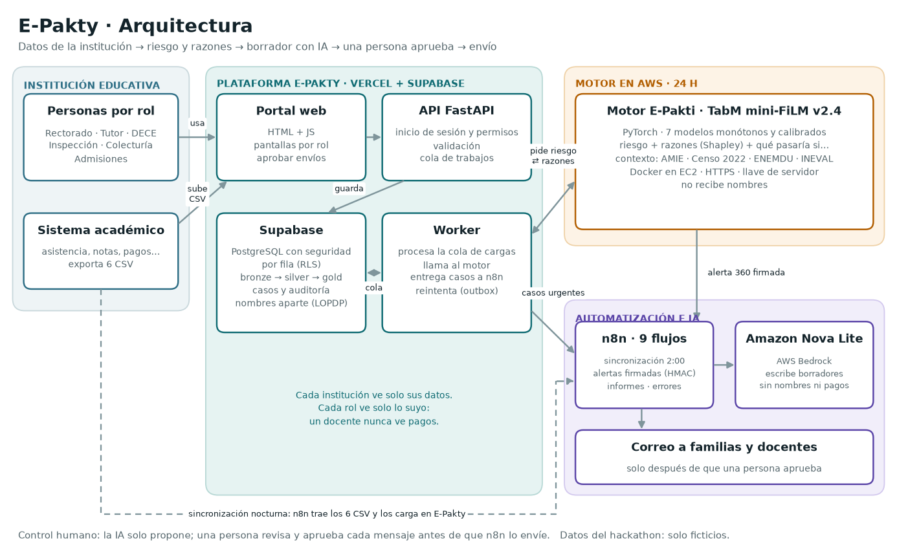

# E-Pakty · Alerta temprana para el ecosistema educativo

**Track 1 · Problemáticas de la educación** · Hackathon EduTech Eight Academy by n8n 2026

| | |
|---|---|
| **Demo en vivo** | https://ed.paktai-ec.com |
| **Documentación del sistema** | https://ed.paktai-ec.com/docs.html |
| **Repositorio** | https://github.com/Jdanielachavez/edutech26-t1-paktai |

> E-Pakty existía antes del hackathon. Lo que ya estaba hecho está declarado en [`PRIOR_WORK.md`](PRIOR_WORK.md) y el uso de inteligencia artificial en [`AI_USAGE.md`](AI_USAGE.md).

---

## Resumen en 30 segundos (para cualquier lector)

- **El problema:** en 2023-2024, **72 644 estudiantes** dejaron el sistema educativo en Ecuador, y en 2024-2025 fueron **66 852** (datos oficiales AMIE). Casi nunca se van de un día para otro: antes faltan, les bajan las notas, decae su bienestar o la familia se atrasa con la pensión. Esas señales existen, pero **están repartidas entre varias personas** y nadie las ve juntas a tiempo.
- **Lo que hace E-Pakty:** **junta los datos que la institución ya tiene** (asistencia, notas, bienestar, pagos), calcula **quién necesita acompañamiento, por qué y qué hacer**, y ayuda a actuar a tiempo. La inteligencia artificial escribe el borrador del mensaje y **una persona siempre lo aprueba** antes de enviarlo.
- **Nuestra mayor fortaleza son los datos:** no pedimos información nueva. Convertimos lo que la institución ya registra todos los días en decisiones concretas.
- **Para quién:** cualquier institución educativa: colegios fiscales, fiscomisionales y particulares, academias, institutos y negocios educativos. **Empezamos por los colegios particulares**, que pierden estudiantes y pensiones (sección 1.6).
- **Qué funciona hoy en vivo:** subir los datos, calcular el riesgo con el motor en AWS, ver la pantalla de cada rol, escribir el borrador con IA, aprobarlo y enviarlo por correo con n8n. Todo con datos ficticios (sección 5.1).

---

## Índice

1. [El problema](#1-el-problema)
2. [Por qué los datos son nuestra mayor fortaleza](#2-por-qué-los-datos-son-nuestra-mayor-fortaleza)
3. [Para quién es: todo el ecosistema educativo](#3-para-quién-es-todo-el-ecosistema-educativo)
4. [Qué resuelve E-Pakty y qué no](#4-qué-resuelve-e-pakty-y-qué-no)
5. [Cómo se resuelve (explicación no técnica)](#5-cómo-se-resuelve-explicación-no-técnica)
6. [Cómo funciona por dentro (explicación técnica)](#6-cómo-funciona-por-dentro-explicación-técnica)
7. [Los modelos que usamos](#7-los-modelos-que-usamos)
8. [n8n: en qué momento entra cada flujo](#8-n8n-en-qué-momento-entra-cada-flujo)
9. [Inteligencia artificial: dónde se usa y cómo se controla](#9-inteligencia-artificial-dónde-se-usa-y-cómo-se-controla)
10. [Privacidad y seguridad (LOPDP)](#10-privacidad-y-seguridad-lopdp)
11. [Resultados en la demostración](#11-resultados-en-la-demostración)
12. [Viabilidad](#12-viabilidad)
13. [Cómo ejecutarlo](#13-cómo-ejecutarlo)
14. [Estructura del repositorio](#14-estructura-del-repositorio)
15. [Limitaciones conocidas](#15-limitaciones-conocidas)
16. [Equipo](#16-equipo)

---

## 1. El problema

### 1.1 Cuántos estudiantes dejan el sistema en Ecuador

Datos oficiales del **Ministerio de Educación (AMIE, datos abiertos)**, calculados con [`data/bronze/public/amie_abandono.csv`](data/bronze/public/amie_abandono.csv):

| Indicador (período 2023-2024) | Dato |
|---|---|
| Estudiantes que abandonaron el sistema en un año | **72 644** de 4 144 414 matriculados (**1,75 %**) |
| En instituciones fiscales | 60 630 estudiantes (**1,97 %**) |
| En instituciones fiscomisionales | 5 048 estudiantes (**1,99 %**) |
| En instituciones particulares | 6 619 estudiantes (**0,84 %**) |
| Zona rural / urbana | 1,83 % / 1,73 % |
| Provincias con más abandono | Morona Santiago **5,21 %** · Esmeraldas **3,06 %** · Orellana **3,02 %** (Pichincha: 1,44 %) |

### 1.2 Cómo ha cambiado en 15 años

| Período | Abandonaron | Tasa |
|---|---|---|
| 2011-2012 (el peor año) | 229 620 | **5,61 %** |
| 2015-2016 | 120 974 | 2,77 % |
| 2019-2020 | 75 295 | 1,73 % |
| 2021-2022 (rebote después de la pandemia) | 90 016 | 2,11 % |
| 2023-2024 | 72 644 | 1,75 % |
| 2024-2025 | 66 852 | 1,62 % |

- Entre 2009 y 2024 se registraron **1 929 569 abandonos**.
- La tasa bajó mucho desde 2012, pero **se estancó cerca del 1,8 %** y **volvió a subir después de la pandemia**.
- En **2024-2025** fueron **66 852** (1,62 %), según el registro AMIE de fin de año del Ministerio de Educación (cálculo del equipo). La cifra baja, pero muy despacio: siguen siendo decenas de miles de estudiantes cada año.

### 1.3 El contexto también pesa

Según la **ENEMDU 2025 del INEC**, el **21,8 %** de la población está en **pobreza por ingresos** y el desempleo es del **3,6 %**. Donde hay más pobreza suele haber más abandono. Por eso E-Pakty ajusta el riesgo según la provincia de la institución.

### 1.4 Por qué las instituciones llegan tarde

Un estudiante casi nunca se va de un día para otro. Antes aparecen señales:

- **Falta seguido sin justificar.** Es la señal más temprana.
- **Le bajan las notas**, sobre todo en las materias clave.
- **Su bienestar empeora**, o tiene una **necesidad educativa especial (NEE)** sin el apoyo adecuado.
- **La familia se atrasa con la pensión.**

**El problema de fondo es que esas señales están repartidas:**

| Señal | Quién la ve hoy |
|---|---|
| Faltas y atrasos | Inspección |
| Notas | Cada docente |
| Bienestar y NEE | DECE |
| Pagos | Colecturía |

Nadie las ve **juntas**, nadie sabe **a quién atender primero**, y cuando la institución se entera, el estudiante ya se fue. Con él se pierden también sus pensiones del resto del año.

### 1.5 Cómo entendimos qué necesita cada persona

- **Quiénes somos.** Los fundadores, **Dani y Wilo, somos economistas**. Leemos los datos oficiales (AMIE, ENEMDU, INEVAL) con criterio, y sabemos que el abandono también pesa en los ingresos de la institución.
- **Investigación profunda.** Revisamos fuentes oficiales y estudios sobre abandono escolar, el rol del DECE, la inclusión de estudiantes con NEE y la morosidad en instituciones particulares.
- **Simulación con 10 agentes de IA distintos.** Con esa investigación armamos una simulación de varios agentes. Cada uno representaba a una persona de la institución: docente tutor, DECE, inspección, vicerrectorado, rectorado, colecturía, admisiones, familia y otros. Así identificamos qué necesita ver y decidir cada uno. De ahí salen las pantallas por rol de la sección 3.
- **Lo declaramos con honestidad:** esa simulación **no reemplaza** a las entrevistas reales. Se usó IA, y está declarado en [`AI_USAGE.md`](AI_USAGE.md).

### 1.6 El usuario concreto y por qué empezamos por los colegios particulares

**La usuaria principal es la tutora de un paralelo.** Por ejemplo, la tutora de 9.º EGB B en un colegio particular de 240 estudiantes como el de la demostración. Tiene a cargo unos 30 a 40 estudiantes. Ve las notas de su materia, pero no las faltas en las otras clases, ni lo que sabe el DECE, ni si la familia está atrasada. Cada lunes necesita saber **a quién llamar esta semana y qué decirle**.

**Quien decide la compra es el rectorado.** En un colegio particular, el rectorado cuida dos cosas a la vez: que el estudiante aprenda y se quede, y que la institución no pierda las pensiones del resto del año.

**Por qué empezamos por los particulares:**

- **Pierden estudiantes, no solo por abandono.** En los particulares el abandono es bajo (0,84 %), pero muchos estudiantes se cambian a otro colegio: **121 300 estudiantes migraron del sistema privado al público en el ciclo Costa 2025** ([El Diario, julio de 2025](https://www.eldiario.ec/lamarea/el-10-de-padres-en-ecuador-no-pagan-pensiones-a-tiempo-revela-informe-20250731/)).
- **Tienen mora.** Según el informe «Educación en Cifras» de la fintech Mattilda, el **10 % de las familias** de colegios privados se atrasa hasta 4 meses con la pensión (misma fuente).
- **Son un mercado medible.** Hay **791 colegios particulares** con 150 o más estudiantes de 8.º EGB a 3.º BGU: 203 en Guayaquil, 177 en Quito y 37 en Cuenca (registro AMIE de inicio 2025-2026, cálculo del equipo).
- **Pueden pagar una suscripción** y decidir rápido. Los colegios fiscales, donde el abandono es mayor (1,97 %), son la siguiente etapa, por convenio con el Ministerio o con fundaciones.

### 1.7 Evidencia de que actuar a tiempo funciona

Un ensayo aleatorio del Instituto de Ciencias de la Educación de EE. UU. (IES, 2017), en **73 colegios y más de 35 000 estudiantes**, probó un sistema de alerta temprana con seguimiento. En un año, el **ausentismo crónico bajó de 14 % a 10 %** y los estudiantes que reprobaban al menos una materia **bajaron de 26 % a 21 %**. No cambió el promedio de notas ([informe REL 2017-272](https://ies.ed.gov/use-work/resource-library/report/impact-study/getting-students-track-graduation-impacts-early-warning-intervention-and-monitoring-system-after-one)).

E-Pakty sigue esa misma lógica: **alerta, acción de una persona y seguimiento registrado**. No es evidencia de nuestro impacto. Esa la medimos en el piloto.

### 1.8 Lo que todavía no tenemos

- **Entrevistas de campo documentadas** con docentes tutores, DECE y rectores. Por ahora es una demostración; las entrevistas van con el piloto.
- **Validación con retiros reales.** Los modelos se midieron con una institución ficticia de 240 estudiantes. El siguiente paso es un piloto.

---

## 2. Por qué los datos son nuestra mayor fortaleza

**E-Pakty no le pide a la institución información nueva.** Trabaja con lo que la institución ya registra todos los días, y lo convierte en decisiones.

### 2.1 Qué datos usa

| Dato que la institución ya tiene | Qué nos dice |
|---|---|
| **Asistencia diaria** (faltas, justificadas, atrasos, primera hora) | La señal más temprana de que algo está pasando |
| **Notas por parcial y quimestre** | Si el estudiante está por reprobar y en qué materia |
| **Necesidades educativas especiales (NEE)** | Quién necesita una adaptación y en qué área |
| **Bienestar** (si existe el registro) | Señales que no se ven en las notas |
| **Pensiones y pagos** | Qué familias podrían atrasarse, y si eso se junta con otras señales |
| **Horarios y docentes** | Dónde se concentran las faltas y las notas bajas |
| **Datos públicos del país** (AMIE, ENEMDU, INEVAL) | El contexto de la zona: abandono, pobreza y desempleo |

### 2.2 Por qué le sirven los datos a una institución educativa

- **Actuar antes, no después.** Con los datos se ve el problema semanas antes de que el estudiante se vaya.
- **Saber a quién atender primero.** El equipo tiene tiempo limitado: los datos ordenan la lista de más urgente a menos.
- **Saber por qué.** No es lo mismo un estudiante que falta que uno que reprueba: cada caso necesita una acción distinta.
- **Proteger los ingresos.** Cada estudiante que se queda es una pensión que la institución no pierde. Los datos muestran cuánto está en riesgo y cuánto se puede recuperar.
- **Incluir mejor.** Los datos de NEE muestran en qué materia necesita apoyo cada condición (por ejemplo, Matemática en discalculia).
- **Medir si funcionó.** Cada acción queda registrada, y la siguiente carga muestra si el riesgo bajó.
- **Rendir cuentas.** El rectorado tiene un panel con cifras claras para el directorio, las familias o el Ministerio.
- **Mejorar con el tiempo.** Cada carga queda guardada en el historial, y los modelos se pueden volver a entrenar con más datos.

### 2.3 Cómo los cuidamos

- Los datos se usan **sin nombres** (códigos `EST-…`, `REP-…`, `DOC-…`). Los nombres se guardan aparte.
- **Cada persona ve solo lo que le corresponde**: un docente nunca ve pagos, y Colecturía nunca ve notas.
- **Cada carga queda guardada** y se compara con la anterior. Administración puede eliminar una carga de prueba del historial.

---

## 3. Para quién es: todo el ecosistema educativo

E-Pakty sirve para **cualquier entorno educativo que registre asistencia, notas y pagos**. Como el sistema es modular (cada rol y cada flujo se activan por separado), se adapta a cada tipo de institución. **El primer cliente es el colegio particular** (sección 1.6).

| Tipo de institución | Para qué le sirve |
|---|---|
| **Colegios fiscales, fiscomisionales y particulares** | Evitar el abandono, acompañar a tiempo y cuidar las pensiones |
| **Academias, institutos y centros de refuerzo o de idiomas** | Detectar a quién le está costando y quién podría dejar el curso |
| **Negocios y comercios educativos** (cursos, programas, plataformas) | Reducir la deserción de sus estudiantes y la morosidad |
| **Redes de instituciones** | Comparar sus sedes con los mismos indicadores |

### Dentro de una institución, cada persona tiene su propia pantalla

| Rol | Qué ve | Qué decide |
|---|---|---|
| **Docente tutor** | *Mi aula*: su paralelo, el calendario de faltas, a quién acompañar y por qué | A quién llamar o citar esta semana |
| **DECE** | Estudiantes con NEE o bienestar bajo y la materia donde más apoyo necesitan | Qué adaptación o acompañamiento dar |
| **Inspección / Vicerrectorado** | Docentes con más notas bajo 7 y faltas por clase | Dónde reforzar |
| **Rectorado** | Panel con pensiones en riesgo, plan de acción y avance del seguimiento | Dónde poner el esfuerzo |
| **Colecturía** | Familias con riesgo de atraso, el motivo y qué hacer (sin datos académicos) | A qué familia ofrecer una intervención de pago |
| **Admisiones** | Evaluación de postulantes desde el día 1 | Qué apoyo preparar antes de que entre |
| **Familia** | Un mensaje claro y humano, aprobado por la institución | — |

Desde administración se puede **ver el portal como cada rol**, para mostrar cómo trabaja cada persona.

---

## 4. Qué resuelve E-Pakty y qué no

**Resuelve:**
- **Junta** en un solo lugar las señales que hoy están repartidas.
- **Prioriza:** Urgente (esta semana), Pronto, Observar o Va bien.
- **Explica** por qué cada estudiante está en la lista, en palabras simples.
- **Recomienda** qué hacer y estima cuánto bajaría el riesgo con cada acción.
- **Automatiza** lo repetitivo: el borrador del mensaje, el aviso al docente, la carga nocturna de datos.
- **Registra** todo el seguimiento, para que no se pierda la historia de cada estudiante.

**No hace:**
- **No decide** por la institución.
- **No reemplaza** al DECE ni al docente: les da información, no un veredicto.
- **No le muestra a la familia** un porcentaje de riesgo.
- **No envía nada** sin que una persona lo apruebe.
- **No resuelve las causas de fondo** del abandono (pobreza, inseguridad, migración de la familia). Ayuda a la institución a darse cuenta a tiempo y a acompañar.
- **No reemplaza el sistema académico** de la institución: lee lo que ese sistema ya exporta.

---

## 5. Cómo se resuelve (explicación no técnica)

1. **La institución sube sus datos.** Son 6 archivos que ya tiene (estudiantes, asistencia, notas, pensiones, horarios y docentes). Se suben desde el portal o, mejor aún, **n8n los trae solos cada noche** a las 2:00.
2. **E-Pakty revisa y protege los datos.** Comprueba que estén completos y cambia los nombres por códigos.
3. **El motor calcula el riesgo.** Una red neuronal estima, para cada estudiante, qué tan probable es que deje la institución, que repruebe o que la familia se atrase con la pensión, **y por qué**.
4. **Cada persona ve su pantalla.** El tutor ve su aula, el DECE sus casos, el rectorado su panel, Colecturía sus familias.
5. **La IA prepara el mensaje.** Escribe un borrador amable para la familia y una acción para el equipo.
6. **Una persona lo revisa y lo aprueba.** Puede editarlo antes de enviarlo.
7. **n8n lo envía** por correo a la familia o al docente.
8. **Todo queda registrado.** Las acciones y su resultado se guardan, y en la próxima carga se ve si el riesgo bajó.

**Tiempos medidos en las pruebas:**

| Qué | Tiempo |
|---|---|
| Subir los 6 archivos y recalcular todo | **31 segundos** |
| Sincronización nocturna automática con n8n | **19,5 segundos** (repetirla no duplica nada) |
| La IA escribe el borrador de un mensaje | unos **3 segundos** |

---

### 5.1 La demostración en vivo: qué se ejecuta de verdad

Este es el recorrido de la demostración (3 minutos). Todo corre en vivo, con el colegio ficticio de 240 estudiantes:

| Paso | Qué se ve | ¿En vivo? |
|---|---|---|
| 1 | Rectorado sube los 6 archivos del colegio desde el portal | Sí: la API, el worker y el motor en AWS recalculan todo (unos 31 s) |
| 2 | Panel de Rectorado: prioridades, pensiones en riesgo y plan de acción | Sí, con lo que calculó el motor |
| 3 | La tutora entra a *Mi aula*: un estudiante **Urgente**, sus razones y qué pasaría con cada acción | Sí |
| 4 | Se pide el borrador del mensaje a la familia | Sí: Amazon Nova Lite lo escribe en unos 3 s |
| 5 | Una persona lo revisa, lo edita y lo aprueba | Sí |
| 6 | n8n envía el correo y el caso queda en *Seguimiento* | Sí. En modo de prueba, el correo llega a una dirección del equipo, nunca a una familia |

**Lo que declaramos:** los datos son ficticios. n8n y el worker corren en una computadora del equipo y se publican con un túnel (sección 15). El motor corre en AWS las 24 horas.

## 6. Cómo funciona por dentro (explicación técnica)

### 6.1 Arquitectura



El mismo recorrido en texto:

```
 ┌─────────────── Fuentes de datos ───────────────┐
 │ Portal: subir 6 CSV  │  n8n: sincronización 2:00 │
 └───────────┬───────────────────────┬────────────┘
             ▼                       ▼
   Portal web (Vercel) ──► API FastAPI (Vercel) ──► Supabase PostgreSQL
   HTML/JS, pantallas        roles y permisos         · seguridad por fila (RLS)
   por rol                   validación               · bronze / silver / gold
                             cola de trabajos          · historial de cargas
                                                       · nombres aparte
             │
             ▼
   Worker ──────────────► Motor E-Pakti · TabM mini‑FiLM v2.4 (AWS, 24 h)
   procesa la cola          PyTorch, 7 modelos, devuelve riesgo + razones
             │
             ▼
   n8n (automatización) ──► Amazon Nova Lite (AWS Bedrock) ──► correo
   9 flujos                  redacta borradores e informes        a familias y docentes
```

### 6.2 Componentes

| Pieza | Tecnología | Qué hace |
|---|---|---|
| **Portal** | HTML + JavaScript, en Vercel | Pantallas por rol, paneles interactivos, informes en PDF |
| **API** | Python, FastAPI, en Vercel | Inicio de sesión, permisos por rol, validación, cola de trabajos |
| **Base de datos** | Supabase (PostgreSQL) con Row Level Security | Guarda las cargas (bronze, silver, gold), casos, seguimiento y auditoría |
| **Worker** | Python | Procesa las cargas, llama al motor y entrega los mensajes a n8n |
| **Motor** | TabM mini‑FiLM v2.4 (PyTorch) en AWS | Calcula el riesgo y sus razones |
| **Modelo explicativo** | Regresión logística propia | Muestra qué factores pesan; respaldo si el motor no responde |
| **Automatización** | n8n | Borradores con IA, envíos de correo, alertas del motor, sincronización nocturna |
| **IA generativa** | Amazon Nova Lite (AWS Bedrock) | Redacta borradores de mensajes e informes en palabras simples |

### 6.3 Las capas de datos

| Capa | Qué guarda |
|---|---|
| **Bronze** | Los archivos tal como llegaron, ya sin nombres. Cada carga queda guardada. |
| **Silver** | Los datos limpios por estudiante, en cada carga |
| **Gold** | El resultado listo para las pantallas (riesgo, prioridad, razones) |
| **Nombres** | Aparte del resto, con fecha de borrado (LOPDP) |

### 6.4 Si algo falla

- Si el motor no responde, la carga queda marcada con un mensaje claro y el portal sigue mostrando la última carga buena.
- Los mensajes pendientes se reintentan solos (patrón *outbox*).
- Subir dos veces los mismos archivos no duplica nada.
- El portal reutiliza los datos 60 segundos para no esperar al servidor en cada clic.

---

## 7. Los modelos que usamos

### 7.1 Motor E-Pakti · TabM mini‑FiLM v2.4

Red neuronal tabular (PyTorch) desarrollada por el equipo antes del hackathon (ver [`PRIOR_WORK.md`](PRIOR_WORK.md)). Corre en la nube las 24 horas. Tiene **7 modelos**, cada uno para anticipar un problema distinto. Con el modelo explicativo de la sección 7.2, E-Pakty usa **8 modelos en total**. Su validación **fuera de muestra** (OOF) sobre la cohorte ficticia de 240 estudiantes:

| Qué anticipa | AUC-ROC | Lectura |
|---|---|---|
| Que repruebe el 2.º quimestre (nota menor a 7) | **0,947** | Bueno |
| Admisión: que le cueste en notas | **0,928** | Bueno |
| Que falte seguido a clases | 0,768 | Aceptable |
| Que la familia llegue a deber 2 meses o más | 0,765 | Aceptable |
| Admisión: que la familia llegue a deber 2 meses o más | 0,687 | Débil |
| Que la familia pague tarde 2 veces o más | 0,601 | Débil |
| Admisión: que la familia pague tarde | 0,566 | Débil |

*AUC-ROC: 0,5 es adivinar al azar y 1 es acertar siempre.* El riesgo de **permanencia** de cada estudiante sale del modelo de faltas repetidas, porque faltar seguido es la señal más temprana de que un estudiante se puede ir.

**El motor pasa 22 de 22 pruebas automáticas**, entre ellas:
- más faltas nunca bajan el riesgo;
- dos hermanos no se mezclan al medir;
- **ningún docente ve datos de pagos** (0 términos financieros en 40 vistas docentes).

En la pantalla de MLOps también se ven la AP, el Brier, la calibración, la precisión y la exhaustividad en los primeros 20, 40 y 60 estudiantes, y una curva de captura por modelo.

**Cómo funciona el motor por dentro:**

- **Mira tres niveles a la vez:** el estudiante (asistencia, notas, NEE y pagos), su institución y su territorio (parroquia del Censo 2022, cantón del registro AMIE y provincia de la ENEMDU). Las parroquias están homologadas con el Censo 2022 en un 99,96 %.
- **Respeta el sentido común:** la red tiene restricción de signo, así que más faltas o peores notas **nunca bajan el riesgo**.
- **Da porcentajes calibrados:** la calibración se hace fuera de muestra, para que un 40 % se parezca a lo que pasa en 4 de cada 10 casos.
- **No hace trampa al medir:** la validación separa por familia, así que dos hermanos nunca quedan uno para entrenar y otro para medir.
- **Explica cada caso:** cada riesgo se descompone en la suma exacta del aporte de cada factor (valores de Shapley). De ahí salen las razones en puntos que ve la tutora.
- **Corre aislado y seguro:** en AWS (Docker con HTTPS), con llave de servidor, separación por institución y permisos por rol. Arranca vacío y no recibe nombres.

### 7.2 Modelo explicativo propio

Regresión logística con 11 factores ([`backend/reference_model.py`](backend/reference_model.py)). Muestra **qué factores pesan** y sirve de respaldo transparente.

### 7.3 Cómo se lee el riesgo

- **Prioridad:** Urgente (actuar esta semana), Pronto, Observar o Va bien. Compara al estudiante con el resto de su institución.
- **Razones:** cada alerta dice por qué, por ejemplo: "falta al menos un día casi todas las semanas, +26 puntos".
- **Qué pasaría si…:** cuánto bajaría el riesgo con cada acción (plan de asistencia, tutoría o ambas).
- **Contexto de la zona:** el riesgo se ajusta con el abandono y la pobreza de la provincia.

---

## 8. n8n: en qué momento entra cada flujo

n8n es la pieza que **conecta todo y hace el trabajo repetitivo**. Los flujos están exportados en [`n8n/`](n8n/). Así entra cada uno, en orden:

| Momento | Flujo | Qué lo activa | Qué hace | ¿Aprobación humana? |
|---|---|---|---|---|
| **1. Cada noche, 2:00** | **Sincronización nocturna** ([json](n8n/epakti_sincronizacion_nocturna.json)) | Un reloj (cron `0 2 * * *`) | Descarga los 6 CSV del sistema de la institución y los envía a E-Pakty | No: solo carga datos |
| **2. Después de cada carga** | **Borrador con Nova Lite** ([json](n8n/paktai_borrador_bedrock_local.json)) | El worker, con los estudiantes más urgentes | Por cada estudiante: reserva el caso, la IA escribe el borrador para la familia y la acción interna, y lo guarda en el caso | **Sí**: queda pendiente de revisión |
| **3. Cuando el motor detecta alertas** | **Alerta 360 del motor** ([json](n8n/epakti_alerta_360_firmado.json)) | El motor en la nube | **Verifica la firma HMAC** (si no es válida responde 401), separa la información por rol (lo pedagógico sin pagos; lo de Colecturía sin NEE), ajusta por NEE con el DECE, la IA prepara el plan según el motivo y registra la intervención en el motor | Sí, antes de enviar a una familia |
| **4. Cuando una persona aprueba** | **Entrega a familia** ([json](n8n/epakti_entrega_correo.json)) | El botón *Aprobar envío* | Envía el mensaje aprobado por correo. WhatsApp está pendiente de configurar | Ya fue aprobado |
| **5. Cuando se avisa al docente** | **Aviso al docente** ([json](n8n/epakti_aviso_docente.json)) | Marcar en Seguimiento "Docente avisado" | Envía al docente un correo con el resumen y qué hacer | Lo decide quien lo marca |
| **6. Cuando alguien pide el informe simple** | **Redactar informe** ([json](n8n/epakti_redactar_informe.json)) | El botón *Explicar en palabras simples (IA)* | La IA reescribe el informe; si inventa una cifra, se descarta | Es solo lectura |
| **7. Cuando se sube un examen** | **Lector de exámenes** ([json](n8n/epakti_examen_ocr.json)) | Fotos de una evaluación | La IA lee las hojas y devuelve las notas **para revisar** | Sí: se revisa antes de guardar |
| **8. Desde la página web** | **Contacto comercial** ([json](n8n/epakti_contacto_lead.json)) | El formulario de contacto | Avisa al equipo de un interesado | No |
| **Siempre** | **Registro de errores** ([json](n8n/epakti_errores.json)) | Cualquier falla de otro flujo | Registra el error y avisa al administrador | No |

**El recorrido de la Alerta 360, paso a paso:**

```
webhook ─► verificar firma HMAC ─► ¿válida? ─ no ─► 401
                                     │ sí ─► 202 (recibido)
                                     ▼
separar alertas ─► vista pedagógica (sin pagos) ─┐
               └─► vista Colecturía (sin NEE)  ──┤
                                                 ▼
ajuste por NEE (DECE) ─► elegir según el motivo ─► Amazon Nova Lite
  ├─ tutor / DECE
  ├─ permanencia / inspección
  └─ Colecturía
          ▼
preparar alerta ─► correo interno de prueba ─► registrar el resultado en el motor
```

**Cómo se protegen estas conexiones:**
- Lo que el motor envía a n8n va **firmado con HMAC-SHA256**; n8n rechaza cualquier firma inválida.
- Lo que la API envía a n8n lleva un **token**.
- n8n solo publica las rutas de los flujos: **el editor no queda expuesto**.
- En modo de prueba, **todos los correos se desvían a una sola dirección del equipo**, para que nunca le llegue nada a una familia por error.

### Qué verifica cada flujo, sus límites y qué pasa si falla

| Flujo | Qué verifica | Límite conocido | Si falla |
|---|---|---|---|
| Sincronización nocturna | Que lleguen los 6 archivos. Repetirla no duplica nada | Depende de que el sistema de la institución entregue sus archivos | La carga queda marcada con un mensaje claro y el portal sigue mostrando la última carga buena |
| Borrador con Nova Lite | Reserva cada caso para no escribir dos borradores | La IA puede equivocarse en el tono o en el detalle | Queda pendiente de revisión: nada se envía sin aprobación |
| Alerta 360 del motor | La firma HMAC de cada alerta y la separación por rol | Los modelos de pagos aciertan menos (sección 15) | Una firma inválida recibe 401 y no se procesa |
| Entrega a familia | Que el mensaje esté aprobado | WhatsApp todavía no está configurado | Los mensajes pendientes se reintentan solos (patrón *outbox*) |
| Redactar informe | Que no aparezcan cifras que no estaban en el informe | Solo reescribe, no calcula | Si inventa una cifra, el texto se descarta |
| Lector de exámenes | Devuelve las notas para revisar | Puede leer mal una hoja | Nada se guarda sin revisión humana |
| Registro de errores | Captura las fallas de los demás flujos | — | Registra el error y avisa al administrador |

Los 12 archivos de los flujos están exportados en [`n8n/`](n8n/), listos para importar con `./scripts/n8n_import_all.sh`.

---

## 9. Inteligencia artificial: dónde se usa y cómo se controla

| Dónde | Modelo | Para qué |
|---|---|---|
| Predicción del riesgo | TabM mini‑FiLM v2.4 (red neuronal) | Calcular el riesgo y sus razones |
| Explicación de factores | Regresión logística propia | Mostrar qué pesa, de forma transparente |
| Borrador del mensaje | Amazon Nova Lite | Escribir el mensaje para la familia y la acción interna |
| Informe en palabras simples | Amazon Nova Lite | Reescribir el informe para cualquier lector |
| Lector de exámenes | Amazon Nova Lite | Extraer notas de un examen escaneado |

**Controles:**
- **La IA nunca decide ni envía.** Solo propone; una persona aprueba.
- **La IA nunca ve nombres** ni datos de pagos.
- **Si la IA inventa una cifra** que no estaba en el informe, el texto se descarta.
- Todo el uso de IA, incluida la que usamos para construir, está declarado en [`AI_USAGE.md`](AI_USAGE.md).

**Límites que conocemos:**
- Un riesgo alto es una **señal para revisar**, no un diagnóstico. Que un factor pese mucho indica asociación, no causa.
- Los modelos se validaron con una **institución ficticia**. Con datos reales hay que volver a medirlos en el piloto.
- La IA generativa puede escribir un tono inadecuado o leer mal un examen: por eso siempre revisa una persona.

---

## 10. Privacidad y seguridad (LOPDP)

- **Solo datos ficticios** en el hackathon.
- **Seudonimización:** los nombres se guardan aparte; todo lo demás usa códigos. El motor nunca recibe nombres.
- **Seguridad por fila** en la base: cada institución solo ve sus datos.
- **Permisos por rol** en la API y en las pantallas.
- **Auditoría:** cada inicio de sesión, aprobación y cambio queda registrado.
- **Retención:** los nombres tienen fecha de borrado.

---

## 11. Resultados en la demostración

Institución ficticia de **240 estudiantes**:

| Indicador | Dato |
|---|---|
| Prioridad de los estudiantes | **95** urgentes · **10** pronto · **56** observar · **79** van bien |
| Estudiantes con NEE | 92 |
| Pensiones por cobrar (8 meses) | $321 086 |
| Ingresos de estudiantes en alerta | $142 524 |
| Recuperable si se interviene (estimación del modelo) | $41 109 |
| Pérdida estimada si no se actúa (estimación del modelo) | $130 311 |

Son estimaciones sobre datos ficticios: sirven para mostrar cómo razona el sistema, no como promesa de resultados.

---

## 12. Viabilidad

- **Quién lo usa:** la institución (rectorado, DECE, tutores, inspección, colecturía y admisiones).
- **Quién paga:** la institución, con una **suscripción mensual**.

**Costo aproximado** (estimación del equipo, se ajusta con el piloto):

| Concepto | Costo aproximado |
|---|---|
| Suscripción por institución | US$ 290 al mes (unos US$ 1,20 por estudiante al mes en una institución de 240 estudiantes, como la de la demostración) |
| Implementación inicial (conectar sus datos, capacitar al equipo) | US$ 250, una sola vez |
| Costo de operar por institución (motor en AWS, base de datos, n8n, IA) | unos US$ 85 al mes (supuesto del plan financiero) |

**Por qué se paga solo:** la institución de la demostración tiene $41 109 recuperables si interviene a tiempo (estimación del modelo). Con una suscripción de US$ 290 al mes, eso equivale a unos 142 meses de servicio. Dicho de otra forma: con una pensión de bachillerato de US$ 206 al mes (la media de Quito según datos del Ministerio de Educación), basta con que se queden unos 2 estudiantes más al año para cubrir la suscripción.

**Para el negocio:** con estos supuestos, E-Pakty cubre sus costos con unas 17 instituciones activas.

- **Por qué le conviene:** cada estudiante que se queda es una pensión que no se pierde, y un estudiante que termina sus estudios.
**Ruta de adopción en una institución real:**

1. **Semana 1:** acuerdo con el rectorado y carga inicial de sus datos seudonimizados, desde la exportación de su sistema académico (implementación).
2. **Semanas 2 a 12:** piloto con tutores, DECE, Inspección y Colecturía. Cada semana, el equipo revisa la lista priorizada y registra qué hizo con cada caso.
3. **Al cerrar el piloto:** comparar con el período anterior los casos atendidos a tiempo, las faltas, las notas y la mora. Con eso, la institución decide si mantiene la suscripción.

- **Siguiente paso concreto:** un **piloto con una institución real**, con sus datos seudonimizados, para validar los modelos con retiros reales y conectar la sincronización nocturna con su sistema académico.

---

## 13. Cómo ejecutarlo

**Probarlo:** entra a https://ed.paktai-ec.com. Desde la portada se recorre la demostración con datos ficticios, o se inicia sesión con un usuario del equipo.

**En local** (ver [`docs/DESARROLLO_LOCAL.md`](docs/DESARROLLO_LOCAL.md)):

```bash
infra/dev/dev-up.sh
set -a; . ./.env.dev; set +a; .venv/bin/python -m backend.server
cd frontend-v2 && python3 -m http.server 8800 --bind 127.0.0.1
```

Las variables necesarias están en [`.env.example`](.env.example) y en [`env/`](env/).

**Pruebas:** `TEST_DATABASE_URL="$DATABASE_URL" .venv/bin/python -m pytest -q backend/tests`.

**Encender producción completa para una demostración** (n8n, IA, correo, worker y sincronización nocturna):

```bash
./scripts/encender_produccion.sh
```

| Otras tareas | Comando |
|---|---|
| Reiniciar la API y el worker locales | `./scripts/reiniciar_local.sh` |
| API contra Supabase | `./scripts/dev_supabase.sh 8011` |
| Importar los flujos en n8n | `./scripts/n8n_import_all.sh epakty-n8n` |
| Cambiar la dirección del motor en producción | `./scripts/vercel_motor.sh <url>` |

---

## 14. Estructura del repositorio

| Carpeta | Qué hay |
|---|---|
| [`frontend-v2/`](frontend-v2/) | Portal web: portada, demostración y pantallas por rol |
| [`backend/`](backend/) | API FastAPI (`production/`), modelo explicativo, worker y pruebas (`tests/`) |
| [`engine_stub/`](engine_stub/) | Contrato y simulador del motor para desarrollo local (el código del motor no está en este repositorio) |
| [`sql/`](sql/) | Esquema de la base con seguridad por fila |
| [`n8n/`](n8n/) | Los flujos de n8n exportados |
| [`data/`](data/) | Datos públicos (AMIE, ENEMDU, INEVAL) y la institución ficticia (ver [`data/README.md`](data/README.md)) |
| [`scripts/`](scripts/) | Encender producción, migraciones, túneles y utilidades |
| [`docs/`](docs/) | Diagrama de arquitectura, desarrollo local, despliegue y webhooks |
| [`env/`](env/), [`infra/`](infra/) | Plantillas de variables e infraestructura |

---

## 15. Limitaciones conocidas

- Los modelos **no están validados con retiros reales**; las cifras son de una cohorte ficticia.
- Los modelos de **pagos aciertan menos** (AUC entre 0,57 y 0,77): hay que usarlos con cuidado.
- Que un factor pese mucho indica **asociación, no causa**.
- El motor corre en la nube (AWS) las 24 horas. En la demostración, **n8n y el worker** todavía corren en una computadora del equipo y n8n se publica con un túnel temporal: **esa computadora debe estar encendida**. En una institución real correrían en un servidor.
- WhatsApp todavía no está configurado; hoy los mensajes salen por correo.

---

## 16. Equipo

Los fundadores somos economistas.

| Integrante | Qué construyó |
|---|---|
| **Dani** (Daniela Chávez) | Producto y plataforma: portal web por rol, API, base de datos con seguridad por fila, flujos de n8n e integración con el motor |
| **Wilo** | Datos y modelos: motor E-Pakti (modelos, datos públicos AMIE, Censo y ENEMDU), despliegue en AWS y viabilidad |

---

## Contacto

paktai_ec@outlook.com · WhatsApp +593 96 271 9099
